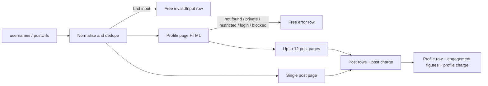

# Instagram Profile & Engagement Scraper

An [Apify](https://apify.com) actor by **[Dataji](https://dataji.io)** that reads public Instagram profiles and posts the way a logged-out visitor sees them. It returns one row per profile (exact followers and following, posts, bio, links in bio, verified badge) with engagement figures calculated from the newest posts, and one row per post (type, date, caption, likes, comments, media). It is for marketers, agencies and researchers who vet influencers or track brands.

| | |
|---|---|
| **Apify actor** | `dataji/instagram-profile-scraper` |
| **Status** | Private, pre-release; live-tested on Apify 18 Nov 2026. On US residential IPs: 5 of 5 profiles (nasa, nike, natgeo, cocacola, starbucks) and 60 posts in 93 s for $0.07 (about $1.10 per 1,000 rows, mostly residential traffic; pages are large). On datacenter IPs Instagram asked to log in for 4 of 5 profiles. |
| **Pricing** | Not set yet; suggested `profile` $3.00 per 1,000 and `post` $2.50 per 1,000 on the free plan, about $2.00 on Gold. Residential traffic must be covered; Apify's official Instagram actors charge $1.50-2.70 per 1,000. |
| **Default proxy** | US residential Apify Proxy. Datacenter IPs got login walls for 4 of 5 profiles on 18 Nov 2026. |
| **Health check** | `dataji/showcase-health-check` (private), weekly |
| **Owner** | Dataji · info@dataji.io |

> This README is for people working on the code. The customer-facing description is
> [`.actor/README.md`](.actor/README.md), which is what the Apify Store shows.

---

## What it does

1. **Reads the input.** `usernames` takes usernames, @handles and profile links; `postUrls` takes `/p/`, `/reel/` and `/tv/` links. Duplicates are removed. Anything else (story, explore, share links) becomes a free `invalidInput` row.
2. **Loads the profile page** `https://www.instagram.com/<username>/` (~800 KB) with curl_cffi Chrome impersonation, one session per proxy IP.
3. **Parses the Relay preloads** embedded in the HTML: the profile (exact follower and following counts) and the grid of the 12 newest posts. The post count comes from the `og:description` meta tag (rounded by Instagram above 9,999).
4. **Opens each recent post** `https://www.instagram.com/p/<shortcode>/` (~680 KB), up to `maxPostsPerProfile` (max 12), on the same worker and proxy IP, paced 2-5 s apart. Each post is pushed and charged as a `post` row.
5. **Pushes the profile row** after its posts, with average likes and comments, engagement rate, posting frequency (pinned posts left out) and last post date.
6. **Single post links** are loaded the same way and pushed as `post` rows.



### Limits and what it never does

- Logged-out only: no login, no account cookies, no tokens, no `/graphql/query` or `/api/v1` calls. The only cookies are the anonymous ones Instagram sets itself.
- No captcha or bot-check bypass. A login redirect is retried once on a fresh proxy session (Instagram sends throttled IPs there); the second time it is a final `loginRequired` row.
- Logged-out Instagram shows only the ~12 newest posts per profile. Older posts need their links in `postUrls`.
- **Comments are out of scope.** The logged-out comment query answers `401 require_login` on every IP type, so it is not called. Preview comments in the post HTML are never read or output.
- Only temporary problems (network errors, timeouts, 429/5xx, an empty shell page) are retried, at most 2 more times on fresh proxy sessions. Requests time out after 30 s.

## Output

Every row has every key, in the same order, with `null` for missing values (see `instagram_profile/output.py`).

| Row | `recordType` | Key fields |
|---|---|---|
| Profile | `profile` | `username`, `fullName`, `userId`, `biography`, `externalUrls`, `isVerified`, `isPrivate`, `followersCount`, `followingCount`, `postsCount`, `recentPostsAnalysed`, `avgLikes`, `avgComments`, `engagementRatePct`, `postingFrequencyPerWeek`, `lastPostAt`, `recentPostUrls` |
| Post | `post` | `shortcode`, `mediaId`, `type`, `takenAt`, `caption`, `hashtags`, `mentions`, `likeCount`, `commentCount`, `imageUrls`, `videoUrl`, `ownerUsername`, `isCollab`, `locationName`, `engagementRatePct` |
| Error | `profile` or `post` | `inputUrl`, `url`, `error`, `errorMessage` (private and restricted profiles also keep their public counts) |

The dataset has **Profiles**, **Posts** and **Errors** views (`.actor/dataset_schema.json`).

## Billing

Pay per event, defined in `instagram_profile/billing.py`:

| Event | Charged for |
|---|---|
| `profile` | Each delivered profile row |
| `post` | Each delivered post row |

Error rows are free, including `privateProfile` and `restricted` rows that carry public counts. A post reachable from two inputs is pushed and charged once. Spending-limit room is reserved before each page is fetched, so the run stops cleanly at the user's limit. Progress is kept in `RUN_STATE`, so a migration or restart never charges a row twice. Do not add the synthetic `apify-default-dataset-item` event to the pricing.

## Input example

```json
{
    "usernames": ["nasa", "@nike", "https://www.instagram.com/natgeo/"],
    "includeRecentPosts": true,
    "maxPostsPerProfile": 12,
    "postUrls": ["https://www.instagram.com/p/DfahZrMjAqq/"],
    "maxConcurrency": 3,
    "proxyConfiguration": { "useApifyProxy": true, "apifyProxyGroups": ["RESIDENTIAL"], "apifyProxyCountry": "US" }
}
```

`maxConcurrency` is 1-10 (default 3). Each concurrent worker uses its own proxy IP.

## Repository layout

```
.actor/                     Apify definition: actor.json, input/dataset/output schemas
└── README.md               Store README (customer-facing)
instagram_profile/
├── main.py                 entry point: input, proxy, state, status messages
├── inputs.py               usernames and links -> unique targets
├── fetch.py                curl_cffi sessions, response classification, retries
├── parser.py               profile and post fields from the Relay preloads
├── output.py               row layout, engagement figures, pinned posts, error codes
├── billing.py              push and charge (profile, post), spending-limit reservation
└── run.py                  workers, profile -> posts -> profile row, RUN_STATE
tests/                      145 offline tests; fixtures/ holds scrubbed real pages
tools/capture.py            saves live pages to raw/ (git-ignored) for new fixtures
Dockerfile                  apify/actor-python:3.13 image
DEVELOPMENT.md              developer notes and data rules
CHANGELOG.md                version history
```

## Run it locally

The fixtures and live tests used US IPs, and Instagram asks datacenter IPs to log in. Use a US connection (ideally residential), or run it on Apify.

```bash
python3.13 -m venv .venv
.venv/bin/pip install -r requirements-dev.txt

# Input goes in storage/key_value_stores/default/INPUT.json, for example:
#   {"usernames": ["nasa"], "maxPostsPerProfile": 3, "proxyConfiguration": {"useApifyProxy": false}}
.venv/bin/python -m instagram_profile
```

Use `"useApifyProxy": false` if you have no Apify proxy password locally. Results land in `storage/datasets/default/`.

## Tests

```bash
.venv/bin/python -m pytest -q
```

145 tests, all offline. `tests/fixtures/` holds real logged-out pages captured on 18 Nov 2026 from a US IP, reduced and scrubbed by `tests/scrub_fixtures.py`: every account not on the brand allow-list becomes `redacted.person.N` and preview comments are replaced. `tests/test_fixtures_privacy.py` fails if a fixture is not reduced and scrubbed. `tests/test_schemas.py` checks that the `.actor` schemas and `.actor/README.md` match the code (fields, error codes, events, defaults). How to add a fixture is in `DEVELOPMENT.md`.

## Deploy

Deploy from the repository root with the Apify CLI. It does not build from GitHub.

```bash
apify push
```

The old Apify CLI can keep running after it prints `Success: Actor was deployed`. It is safe to stop it then.

## Health check

The private actor `dataji/showcase-health-check` runs this actor weekly with a small input. If it reports a problem, run the actor by hand with one or two profiles and read the error rows and log.

## When something breaks

Each input that fails gets a free error row with one of these `error` codes:

| Code | Meaning | What to do |
|---|---|---|
| `notFound` | Instagram's "page isn't available" page or a 404 | Nothing; the profile or post does not exist |
| `privateProfile` | Private account; public counts are kept | Nothing |
| `restricted` | Hidden from logged-out visitors (for example age-gated brands) | Nothing; this needs a login, which we do not do |
| `loginRequired` | Login wall twice, on two proxy IPs | If many rows show it, check the proxy is US residential. Datacenter IPs get this for most profiles |
| `blocked` | No page after 3 tries on 3 proxy IPs | Lower `maxConcurrency`; run again later |
| `invalidInput` | Not a username, profile, post or reel link | Nothing; the input is wrong |
| `failed` | Unexpected problem reading the page | Instagram probably changed its HTML. Capture the page with `tools/capture.py`, compare with `tests/fixtures/` and the keys listed in `parser.py`, add a scrubbed fixture and a test, then fix |

The run's status message and log end with a summary and the number of requests and MB transferred.

## Privacy and compliance

- Only public data a logged-out visitor sees. No login, no comments, no follower lists.
- Preview comments in the post HTML are never read or output.
- Test fixtures are scrubbed of people's data; real names used for scrubbing live only in the git-ignored `raw/scrub_names.txt`, never in code.
- Customer guidance on GDPR, CCPA and Instagram's terms is in the Store README. Removal requests go to privacy@dataji.io.

## License

Proprietary. © 2026 Dataji. All rights reserved. See [LICENSE](LICENSE).
